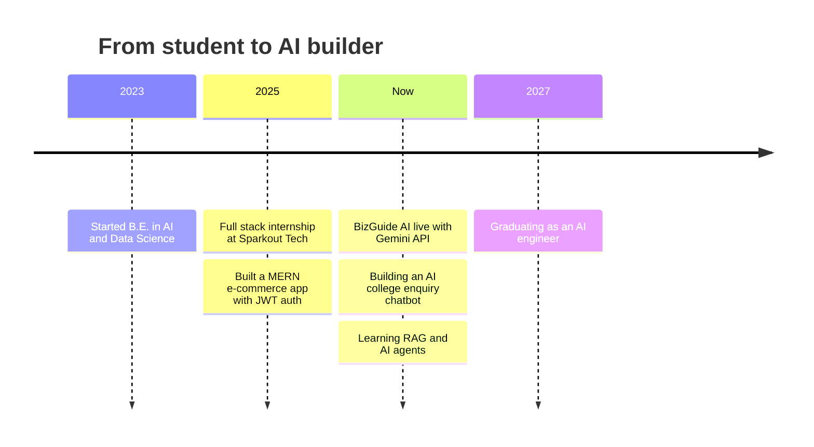
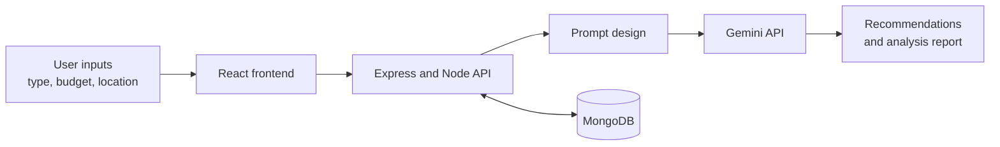

<h1 align="center">Vishwakumar R</h1>

  

  
  
  

---

## About me

I'm a third-year B.E. student in Artificial Intelligence and Data Science from Rajapalayam, Tamil Nadu. I like building things end to end: designing the prompts, wiring up the APIs, building the interface, and putting it online. I care about understanding how my projects work and where they fail.

I'm looking for a **Junior AI Developer** role where I can grow into LLM applications, RAG, and AI agents.

## Currently

- Building an AI chatbot for college admissions enquiries
- Learning RAG and AI agents
- Open to Junior AI Developer roles and internships

## My journey

## Featured projects

**How it works**

**Stack:** MongoDB · Express · React · Node.js · Gemini API
**Links:** [Source code](https://github.com/Vishwakumar-1927/BizGuide-AI) · [Live demo](https://bizguide-ai-frontend.onrender.com)

### AI College Enquiry Chatbot
*In progress*

A chatbot that answers student and visitor questions about admissions, courses, and general college information.

- Focused on understanding user queries and giving accurate, context-aware answers
- Built with Python and NLP techniques

**Stack:** Python · NLP

## Experience

### Full Stack Web Development Intern
**Sparkout Tech Solutions** · June 2025 to July 2025

- Built a MERN e-commerce application with a responsive UI
- Developed REST APIs with Node.js and Express, with data stored in MongoDB
- Implemented secure authentication using JWT and bcrypt
- Worked in a team using Git, GitHub, and agile practices

## Tech stack

**Languages** 
  

**AI and LLMs** 
  

**Backend and databases** 
   

**Frontend** 
  

**Tools** 
   

## Education

**B.E. Artificial Intelligence and Data Science** · 2023 to 2027

## Let's connect

Interested in AI projects, internships, or junior roles? Email me at [vishwakumar1910205@gmail.com](mailto:vishwakumar1910205@gmail.com) or visit my [portfolio](https://vishwakumar-portfolio-ruby.vercel.app).

